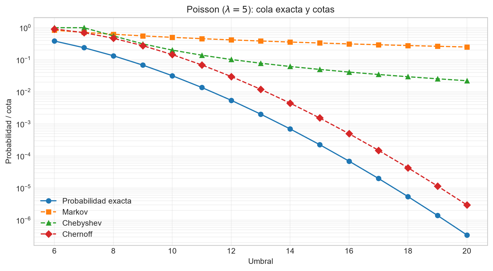
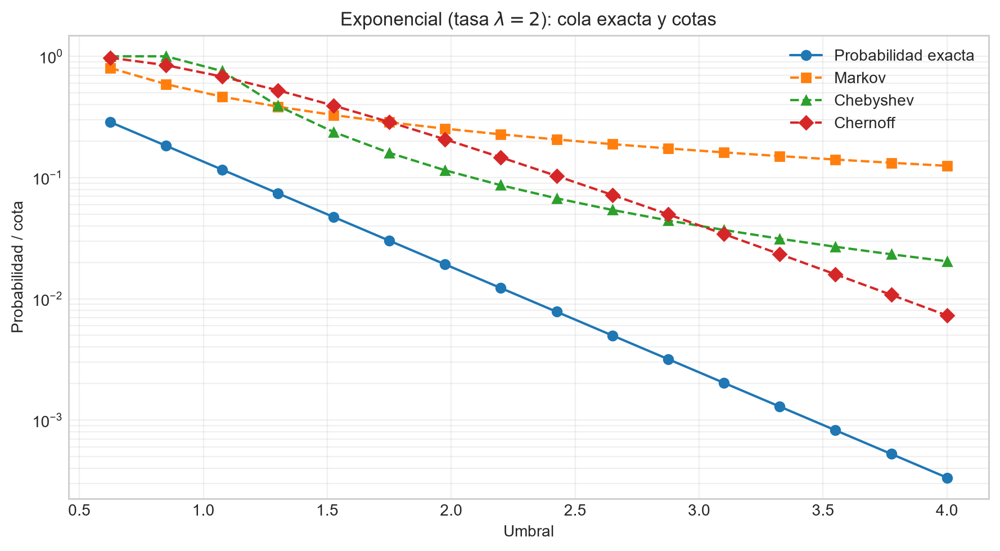

# Desigualdades de Markov, Chebyshev y Chernoff

Proyecto final, tema 6. Probabilidad - Matemáticas para Ciencia de Datos, Maestría en Ciencia de Datos, Universidad de Sonora.

Integrantes: [Nombre 1] y [Nombre 2]. Fecha: [Fecha].

## Resumen

Demostramos las desigualdades de Markov, Chebyshev y Chernoff y las usamos para acotar colas de una Poisson y de una exponencial. Cada cota usa más información que la anterior: la media, la varianza y la función generadora de momentos (FGM). Para $X\sim\mathrm{Poisson}(5)$, $P(X\ge 20)=3.45\times10^{-7}$ y la cota de Chernoff ($2.97\times10^{-6}$) es unas 7 500 veces más chica que la de Chebyshev ($0.0222$). En la exponencial, en cambio, Markov y Chebyshev ganan en umbrales moderados y Chernoff solo gana arriba de unas seis veces la media.

## 1. Planteamiento

Muchas veces nos interesa la probabilidad de que algo se salga mucho de lo normal, por ejemplo que una fila de espera pase de cierto tamaño o que un conteo rebase un umbral. Para calcularla exacta hace falta toda la distribución, y si el evento es muy raro tampoco es facil estimarla simulando. Las desigualdades de este trabajo dan una cota superior usando solo un resumen de la distribución. Seguimos sobre todo a Mitzenmacher y Upfal [1], Blitzstein y Hwang [2] y Ross [3].

### Definiciones

Para una variable aleatoria $X$ y un umbral $a$, la **probabilidad de cola** es $P(X\ge a)$. Usamos $\mu=\mathbb{E}[X]$ para la media y $\sigma^2=\mathrm{Var}(X)=\mathbb{E}[(X-\mu)^2]$ para la varianza. La **indicadora** de un evento $A$ vale 1 si pasa $A$ y 0 si no, y su esperanza es $P(A)$. También usamos que la esperanza es lineal, que si $X\le Y$ siempre entonces $\mathbb{E}[X]\le\mathbb{E}[Y]$, y la regla LOTUS: $\mathbb{E}[g(X)]=\sum_k g(k)P(X=k)$ en el caso discreto y $\mathbb{E}[g(X)]=\int g(x)f(x)dx$ si hay densidad $f$.

La **función generadora de momentos** de $X$ es $M_X(\theta)=\mathbb{E}[e^{\theta X}]$, en los $\theta$ donde esa esperanza es finita; cuando no lo es, escribimos $M_X(\theta)=\infty$. Siempre vale $M_X(0)=1$, y si es finita alrededor de 0, sus derivadas en 0 dan los momentos, $\mathbb{E}[X^n]=M_X^{(n)}(0)$ [2]; de ahí viene su nombre. Por último, una cota $P(X\ge a)\le c$ es **informativa** si $c < 1$; si $c\ge 1$ es cierta pero no dice nada.

### Modelos

- $X\sim\mathrm{Poisson}(\lambda)$: $P(X=k)=e^{-\lambda}\lambda^k/k!$ para $k=0,1,2,\dots$, con media y varianza iguales a $\lambda$.
- $Y\sim\mathrm{Exp}(\lambda)$, con $\lambda$ como tasa: densidad $\lambda e^{-\lambda y}$ para $y\ge 0$, media $1/\lambda$, varianza $1/\lambda^2$ y cola exacta $P(Y\ge a)=e^{-\lambda a}$.

## 2. Desigualdad de Markov

**Teorema 1 (Markov).** Si $X\ge 0$ y $a>0$, entonces

$$P(X\ge a)\le\frac{\mathbb{E}[X]}{a}.$$

*Demostración.* Si $\mathbb{E}[X]$ es infinita no hay nada que probar. Sea $I$ la indicadora del evento $X\ge a$. Primero vemos que siempre $aI\le X$. Si $X\ge a$, entonces $I=1$ y queda $a\le X$, que es cierto. Si $X < a$, entonces $I=0$ y queda $0\le X$, que es cierto porque $X\ge 0$ (es el único paso donde se usa esta hipótesis). Tomando esperanza, $a\mathbb{E}[I]\le\mathbb{E}[X]$, y como $\mathbb{E}[I]=P(X\ge a)$, al dividir entre $a>0$ sale el resultado. $\square$

La idea es que la parte de la distribución que esta de $a$ para arriba aporta por lo menos $aP(X\ge a)$ a la media, así que si la media es chica esa parte no puede pesar mucho. La hipótesis $X\ge 0$ sí hace falta: si $X$ vale 10 o $-10$ con probabilidad $1/2$ cada uno, la media es 0, pero $P(X\ge 5)=1/2$. Además, Markov solo informa si $a>\mu$.

## 3. Desigualdad de Chebyshev

**Teorema 2 (Chebyshev).** Si $X$ tiene media $\mu$ y varianza $\sigma^2$ finita, para todo $t>0$

$$P(\lvert X-\mu\rvert\ge t)\le\frac{\sigma^2}{t^2}.$$

*Demostración.* Sea $Z=(X-\mu)^2$, que es no negativa y tiene media $\sigma^2$. Como $t>0$ y elevar al cuadrado es creciente en los números no negativos, $\lvert X-\mu\rvert\ge t$ pasa exactamente cuando $Z\ge t^2$. Aplicando Markov a $Z$ con el umbral $t^2$:

$$P(\lvert X-\mu\rvert\ge t)=P(Z\ge t^2)\le\frac{\mathbb{E}[Z]}{t^2}=\frac{\sigma^2}{t^2}.$$

Aquí $X$ sí puede ser negativa, porque Markov se aplica a $Z$. $\square$

Para comparar con las otras cotas usamos la cola de arriba. Si $a>\mu$ y $X\ge a$, entonces $X-\mu\ge a-\mu>0$, así que $\lvert X-\mu\rvert\ge a-\mu$, y con $t=a-\mu$ queda

$$P(X\ge a)\le\frac{\sigma^2}{(a-\mu)^2}.$$

Esta cota sólo es menor que 1 si $a-\mu>\sigma$, por eso los umbrales van arriba de la media.

## 4. Cota de Chernoff

**Teorema 3 (Chernoff).** Para cualquier variable $X$, cualquier $a$ y cualquier $\theta>0$,

$$P(X\ge a)\le e^{-\theta a}M_X(\theta),\qquad\text{y por lo tanto}\qquad P(X\ge a)\le\inf_{\theta>0}e^{-\theta a}M_X(\theta).$$

*Demostración.* Fijamos $\theta>0$. Si $M_X(\theta)$ es infinita no hay nada que probar. Si no, como $e^{\theta x}$ es estrictamente creciente, $X\ge a$ pasa exactamente cuando $e^{\theta X}\ge e^{\theta a}$. La variable $e^{\theta X}$ es positiva, así que le podemos aplicar Markov con el umbral $e^{\theta a}>0$:

$$P(X\ge a)=P(e^{\theta X}\ge e^{\theta a})\le\frac{\mathbb{E}[e^{\theta X}]}{e^{\theta a}}=e^{-\theta a}M_X(\theta).$$

Como el lado izquierdo no depende de $\theta$, también queda por debajo del ínfimo. $\square$

Aquí no hace falta que $X\ge 0$, porque Markov se aplica a $e^{\theta X}$. Para encontrar el mejor $\theta$ conviene minimizar el logaritmo de la cota, $\psi(\theta)=\log M_X(\theta)-\theta a$; si $\psi''>0$, el punto donde $\psi'=0$ es el minimo.

## 5. La FGM de la Poisson y de la exponencial

### Poisson

Si $X\sim\mathrm{Poisson}(\lambda)$, por LOTUS y la serie $e^x=\sum_{k\ge 0}x^k/k!$, que converge para todo $x$,

$$M_X(\theta)=\sum_{k=0}^{\infty}e^{\theta k}\frac{e^{-\lambda}\lambda^k}{k!}=e^{-\lambda}\sum_{k=0}^{\infty}\frac{(\lambda e^{\theta})^k}{k!}=e^{-\lambda}e^{\lambda e^{\theta}}=e^{\lambda(e^{\theta}-1)}.$$

Esto vale para todo $\theta$ real.

### Exponencial

Si $Y\sim\mathrm{Exp}(\lambda)$, por LOTUS

$$M_Y(\theta)=\int_0^{\infty}e^{\theta y}\lambda e^{-\lambda y}dy=\lambda\int_0^{\infty}e^{-(\lambda-\theta)y}dy.$$

Si $\theta < \lambda$, la integral vale $1/(\lambda-\theta)$ y entonces $M_Y(\theta)=\lambda/(\lambda-\theta)$. Si $\theta\ge\lambda$, lo que se integra es $e^{(\theta-\lambda)y}\ge 1$, la integral diverge y $M_Y(\theta)=\infty$.

### El intervalo válido

La cola de la exponencial baja como $e^{-\lambda y}$, y el factor $e^{\theta y}$ solo se compensa si crece más despacio, es decir, si $\theta < \lambda$. La cola de la Poisson baja como $\lambda^k/k!$, más rápido que cualquier exponencial, y por eso su FGM es finita para todo $\theta$. En la cota de Chernoff esto quiere decir que en la Poisson sirve cualquier $\theta>0$, pero en la exponencial solo los $\theta$ entre 0 y $\lambda$.

### La mejor cota de Chernoff en cada caso

**Poisson**, con $a>\lambda$: $\psi(\theta)=\lambda(e^{\theta}-1)-\theta a$, con $\psi'(\theta)=\lambda e^{\theta}-a$ y $\psi''(\theta)=\lambda e^{\theta}>0$. Igualando a cero sale $\theta^{\star}=\log(a/\lambda)$, que es positivo porque $a>\lambda$. Al sustituir, $\psi(\theta^{\star})=a-\lambda-a\log(a/\lambda)$, y entonces

$$P(X\ge a)\le e^{-\lambda}\left(\frac{e\lambda}{a}\right)^{a}.$$

Es la misma forma que viene en [1, sección 5.3]. Con $\lambda=5$ y $a=10$ da $e^{5}/2^{10}\approx 0.145$.

**Exponencial**, con $a>1/\lambda$ y $0 < \theta < \lambda$: $\psi(\theta)=\log\lambda-\log(\lambda-\theta)-\theta a$, con $\psi'(\theta)=1/(\lambda-\theta)-a$ y $\psi''(\theta)=1/(\lambda-\theta)^2>0$. Igualando a cero sale $\theta^{\star}=\lambda-1/a$, que sí cae entre 0 y $\lambda$. Entonces $M_Y(\theta^{\star})=\lambda a$ y

$$P(Y\ge a)\le\lambda a e^{1-\lambda a}.$$

Como la cola exacta es $e^{-\lambda a}$, Chernoff se pasa por un factor de $e\lambda a$: atina en la velocidad con la que baja la cola y solo pierde un factor que crece de forma lineal. Con $\lambda=2$ y $a=2$ da $4e^{-3}\approx 0.199$, contra $e^{-4}\approx 0.0183$ exacto.

Si el umbral no pasa de la media, en los dos modelos $\psi'>0$ en todos los $\theta>0$ donde la FGM es finita, así que la mejor cota es 1 y Chernoff solo informa si $a>\mu$.

En la exponencial todo depende de $u=\lambda a$, que es el umbral medido en medias: la cola exacta es $e^{-u}$, Markov da $1/u$, Chebyshev $1/(u-1)^2$ y Chernoff $ue^{1-u}$. Comparando estas expresiones, Markov es la mejor si $u < (3+\sqrt{5})/2\approx 2.62$, Chebyshev si $2.62 < u < 6.02$ y Chernoff si $u>6.02$, sin importar $\lambda$.

## 6. Experimento

En el [cuaderno del proyecto](../notebooks/desigualdades.ipynb) comparamos la cola exacta con las tres cotas para $X\sim\mathrm{Poisson}(5)$ con $k=6,\dots,20$, y para $Y\sim\mathrm{Exp}(2)$, que tiene media 0.5, con 16 umbrales $a=u\mathbb{E}[Y]$ y $u$ entre 1.25 y 8. Todos los umbrales están arriba de la media. La cola exacta la calculamos con `scipy.stats` [4], que equivale a $1-\sum_{j < k}e^{-\lambda}\lambda^j/j!$ en la Poisson y a $e^{-\lambda a}$ en la exponencial, y las cotas con las formulas de arriba.

**Tabla 1.** $X\sim\mathrm{Poisson}(5)$. "$\ge 1$" quiere decir que la cota no informa.

| $k$ | Exacta | Markov | Chebyshev | Chernoff | Mejor cota | Mejor / exacta |
|---|---|---|---|---|---|---|
| 6 | 0.384 | 0.833 | $\ge 1$ | 0.910 | Markov | 2.2 |
| 7 | 0.238 | 0.714 | $\ge 1$ | 0.701 | Chernoff | 2.9 |
| 8 | 0.133 | 0.625 | 0.556 | 0.468 | Chernoff | 3.5 |
| 10 | 0.0318 | 0.500 | 0.200 | 0.145 | Chernoff | 4.6 |
| 20 | $3.45\times10^{-7}$ | 0.250 | 0.0222 | $2.97\times10^{-6}$ | Chernoff | 8.6 |

**Tabla 2.** $Y\sim\mathrm{Exp}(2)$, con $u=a/\mathbb{E}[Y]$.

| $u$ | $a$ | Exacta | Markov | Chebyshev | Chernoff | Mejor cota | Mejor / exacta |
|---|---|---|---|---|---|---|---|
| 1.25 | 0.625 | 0.287 | 0.800 | $\ge 1$ | 0.974 | Markov | 2.8 |
| 2.15 | 1.075 | 0.116 | 0.465 | 0.756 | 0.681 | Markov | 4.0 |
| 3.05 | 1.525 | 0.0474 | 0.328 | 0.238 | 0.393 | Chebyshev | 5.0 |
| 6.20 | 3.100 | $2.03\times10^{-3}$ | 0.161 | 0.0370 | 0.0342 | Chernoff | 16.9 |
| 8.00 | 4.000 | $3.35\times10^{-4}$ | 0.125 | 0.0204 | $7.30\times10^{-3}$ | Chernoff | 21.7 |

**Figura 1.** Cola exacta $P(X\ge k)$ de una Poisson(5) y las tres cotas, para $k=6,\dots,20$. El eje vertical está en escala logarítmica y las cotas mayores que 1 se recortan en 1.

**Figura 2.** Lo mismo para una exponencial con tasa 2, con $a$ entre 0.625 y 4 (de 1.25 a 8 veces la media).

En la Poisson, Chernoff es la mejor cota desde $k=7$, y en $k=20$ queda a un factor de 8.6 del valor exacto, contra $6.4\times10^{4}$ de Chebyshev y $7.2\times10^{5}$ de Markov. En la exponencial el orden cambia con el umbral: de los 16 umbrales, Markov gana en los primeros 4 ($u\le 2.60$), Chebyshev en los 7 siguientes y Chernoff en los últimos 5 ($u\ge 6.20$), como predicen los cortes de la sección 5.

## 7. Discusión y conclusiones

Cada cota usa más información que la anterior, y eso se nota en qué tan rápido baja: Markov como $1/a$, Chebyshev como $1/a^2$ y Chernoff de forma exponencial. Lo que mas nos llamó la atención es que el orden depende del modelo. La cola de la Poisson baja más rápido que cualquier exponencial, y Chernoff, que capta esa caída, gana casi siempre. La exponencial ya baja como $e^{-\lambda a}$; Chernoff baja igual de rápido, pero carga el factor $eu$, que pesa en umbrales moderados, y por eso Markov y Chebyshev le ganan hasta $u\approx 6$.

Al variar $\lambda$, en la exponencial todo queda igual si los umbrales se miden en múltiplos de la media. En la Poisson no: en $k=2\lambda$, Markov siempre da 0.5, Chebyshev $1/\lambda$ y Chernoff $(e/4)^{\lambda}$, así que Chernoff gana más entre más grande es $\lambda$.

Las cotas no son aproximaciones: la diferencia con el valor exacto es el precio de no necesitar toda la distribución, y a cambio sirven para eventos tan raros que sería carísimo simularlos. Su límite es que Chernoff necesita una FGM finita para algún $\theta>0$, y en distribuciones de cola pesada, como la lognormal o la Pareto, eso no pasa.

## Referencias

1. Mitzenmacher, M. y Upfal, E. (2017). *Probability and Computing*, 2.ª ed. Cambridge Univ. Press.
2. Blitzstein, J. K. y Hwang, J. (2019). *Introduction to Probability*, 2.ª ed. Chapman & Hall/CRC.
3. Ross, S. M. (2014). *A First Course in Probability*, 9.ª ed. Pearson.
4. SciPy, documentación de `scipy.stats`: https://docs.scipy.org/doc/scipy/reference/stats.html
